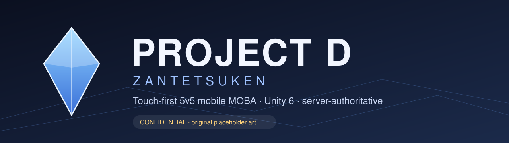
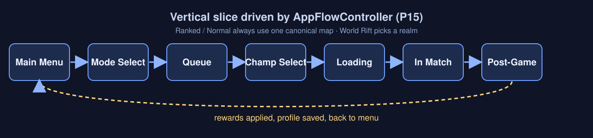
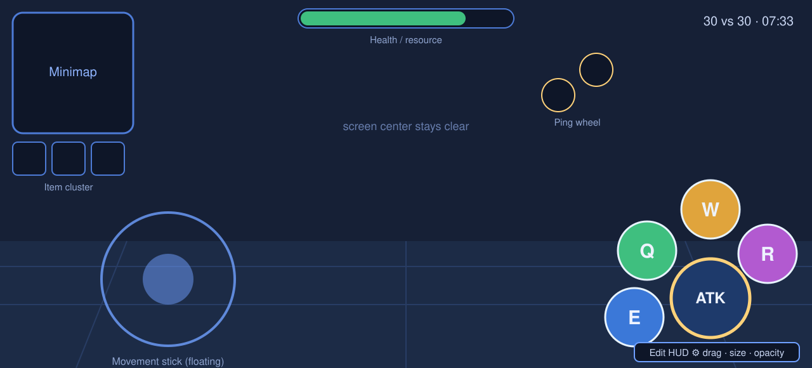
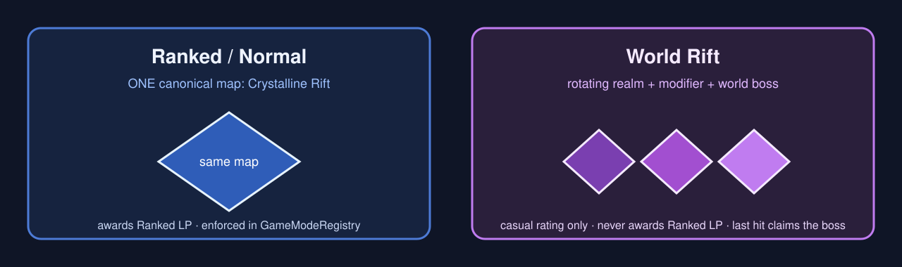
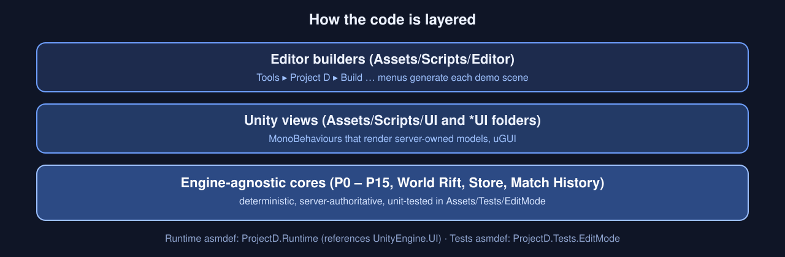

<div align="center">



**A mobile-first 5v5 MOBA built in Unity 6 · codename _Zantetsuken_**

`Unity 6 (6000.5)` · `URP 17.5` · `C#` · `Mobile-first` · `Server-authoritative cores`

</div>

> **CONFIDENTIAL — RESTRICTED DISTRIBUTION.** Project D is a fan-made, Dissidia-inspired concept.
> All Final Fantasy / Dissidia / Square Enix names in this repo are **placeholders**. Game mechanics are
> original. Art in `docs/images/` is original placeholder vector art. Licensed assets require a
> documented chain of title, or must be replaced with original IP, before any public build, test or release.

---

## At a glance

| | |
|---|---|
| **Genre** | 5v5 MOBA, touch-first |
| **Engine** | Unity 6 (`6000.5.10f1`), Universal Render Pipeline 17.5, uGUI 2.5 |
| **Primary platform** | Mobile (two-thumb play). Desktop is secondary |
| **Ranked / Normal map** | One canonical map, **Crystalline Rift**, enforced in code |
| **Rotating mode** | **World Rift** only. Contestable world boss, never awards Ranked LP |
| **Monetisation rule** | No pay-to-win. Trading, crafting, prestige and offers are cosmetic / soft-currency only |

---

## Game flow

The headless vertical slice runs the whole loop with no scene loaded, which is what the tests exercise.



`Boot → Main Menu → Mode Select → Queue → Champion Select → Loading → Match → Post-Game → Main Menu`

---

## Touch HUD (and the customisable layout editor)

Two-thumb layout: movement ring on the left; attack and the **Q / W / E / R** ability arc on the right;
ping wheel and item cluster kept clear of screen centre.



Every control can be **moved, scaled and faded** by the player and is saved per device. See
[`docs/hud-layout-editor.md`](docs/hud-layout-editor.md).

Accessibility rules that must hold for every HUD change:

- Colour is never the only state cue: always shape + icon + text as well.
- Colour-blind-safe team palettes; HUD scale is adjustable.
- Critical telegraphs cannot be disabled.

---

## Ranked vs World Rift



- **Ranked & Normal** always load Crystalline Rift. The game mode registry rejects any other map.
- **World Rift** rotates realms and spawns the **Manifestation** boss. It is claimed by **last hit**
  (stealable) and grants a timed team buff plus a one-shot AoE **Summon Strike**.
- World Rift pays cosmetic KP and adjusts a separate casual rating. It never awards Ranked LP.

Details: [`docs/game-modes-and-world-rift.md`](docs/game-modes-and-world-rift.md) ·
[`docs/world-rift-ui.md`](docs/world-rift-ui.md)

---

## Architecture

Gameplay and systems logic is **engine-agnostic, deterministic and server-authoritative** where possible,
so it can be unit-tested and replayed without Unity. Unity-specific code (views, scene builders, editor tools)
sits on top.



```
Assets/
├── Scripts/              ProjectD.Runtime asmdef  (gameplay, systems, UI)
│   ├── AppFlow/          headless app flow controller (the vertical slice)
│   ├── Store/            in-match gold shop rules
│   ├── UI/               store, HUD, HUD editor, menus
│   └── Editor/           ProjectD.Editor asmdef: scene builders + importers
├── Tests/EditMode/       ProjectD.Tests.EditMode asmdef (NUnit)
├── Scenes/               MainMenu shell, Mode Select, Champion Select, Greybox match
└── GameData/             data only. Never put .cs files here (outside the asmdef)
docs/                     design + system docs, one file per tier
```

---

## Getting started

1. Install **Unity 6 `6000.5.10f1`** (Unity Hub will offer it when you open the project).
2. Clone and open the folder in Unity Hub:
   ```bash
   git clone https://github.com/cmlagatuz/Project-D.git
   ```
3. Let the first import finish. The project should compile with **0 errors**.
4. Use the **Tools → Project D** menu to build scenes and demos, for example:
   - `Build Mode Select`
   - `Build Champion Select Scene`
   - `Build PostGame Results+Analytics`
   - `Build HUD Widgets Demo`
   - `Import …` entries load data (store items, season rewards, localisation, animations, models)
5. Open `Assets/Scenes/Greybox_Prototype.unity` to play the match prototype.

### Pink / magenta screen?

The URP asset is not assigned. Go to **Edit → Project Settings → Quality** and **Graphics** and set the
Render Pipeline Asset to the URP asset in `Assets/Settings/`. Without it, URP materials render magenta.

### Troubleshooting compile errors

- UI types (`Text`, `Image`, `Button`) not found → `ProjectD.Runtime.asmdef` must reference `UnityEngine.UI`
  and the `com.unity.ugui` package must be installed.
- Class name equals its namespace (`Guild`, `Party`, `MatchLoop`) → declare the `using` alias **inside** the
  namespace body. A file-level alias loses to the sibling namespace.
- Unity errors cascade. Fix the first (root) error and re-check before touching the rest.

---

## Tests

EditMode tests cover the engine-agnostic cores: app flow, match loop, store, save/progression glue,
game-mode registry rules and HUD layout persistence.

1. Open **Window → General → Test Runner**.
2. Choose the **EditMode** tab.
3. Click **Run All**.

Test sources live in `Assets/Tests/EditMode/`.

---

## Working with Git

The project is edited both on your machine and by Claude, so keep a clean routine:

```bash
git status                  # anything uncommitted?
git add -A && git commit -m "wip"     # commit (or: git stash) before pulling
git pull --rebase           # bring in the latest updates
git push                    # publish your own work
```

- `Library/`, `Temp/`, `Logs/` and `UserSettings/` are generated by Unity and are **ignored**. Do not commit them.
- Commit `.meta` files together with their assets.
- If a pull complains about local changes, commit or stash first, then pull again.

---

## Documentation

| Area | Docs |
|---|---|
| Coding rules | [`coding-standards.md`](docs/coding-standards.md), [`terminology.md`](docs/terminology.md) |
| Setup | [`prototype-setup.md`](docs/prototype-setup.md), [`build-recommendations.md`](docs/build-recommendations.md) |
| Menus & social | [`p1-menu-social.md`](docs/p1-menu-social.md), [`settings-system.md`](docs/settings-system.md) |
| Champion select & detail | [`champion-select.md`](docs/champion-select.md), [`champion-detail-and-announcer.md`](docs/champion-detail-and-announcer.md), [`champion-codex.md`](docs/champion-codex.md) |
| Match HUD | [`match-hud.md`](docs/match-hud.md), [`hud-layout-editor.md`](docs/hud-layout-editor.md), [`loading-screen.md`](docs/loading-screen.md) |
| Store & items | [`store-ui.md`](docs/store-ui.md), [`store-ui-sell-undo.md`](docs/store-ui-sell-undo.md), [`kp-store.md`](docs/kp-store.md), [`loadout-editor.md`](docs/loadout-editor.md) |
| Modes & ranked | [`game-modes-and-world-rift.md`](docs/game-modes-and-world-rift.md), [`ranked-system.md`](docs/ranked-system.md), [`rank-decay.md`](docs/rank-decay.md), [`season-rewards.md`](docs/season-rewards.md) |
| Post-game | [`postgame-results-ui.md`](docs/postgame-results-ui.md), [`post-game-match-analytics.md`](docs/post-game-match-analytics.md), [`match-history.md`](docs/match-history.md) |
| Networking & server | [`networking.md`](docs/networking.md), [`authoritative-server.md`](docs/authoritative-server.md) |
| Animation & effects | [`animation-pipeline.md`](docs/animation-pipeline.md), [`effects-pipeline.md`](docs/effects-pipeline.md), [`effects-catalog.md`](docs/effects-catalog.md) |
| Delivery plan | [`sprint-plan.md`](docs/sprint-plan.md), per-tier `p*-systems.md` / `p*-backlog.md` |

The full concept documents (`Project_D_Game_Concept_Document_*.docx`, `Project_D_Visual_Concept_Addendum.docx`)
are in the repository root.

---

## IP & confidentiality

- Final Fantasy / Dissidia / Square Enix names are **placeholders** pending original replacements or licensing.
- Do not reproduce copyrighted art, likenesses, lyrics or long copyrighted text in this repo.
- Do not distribute builds or this repository outside the approved group.
