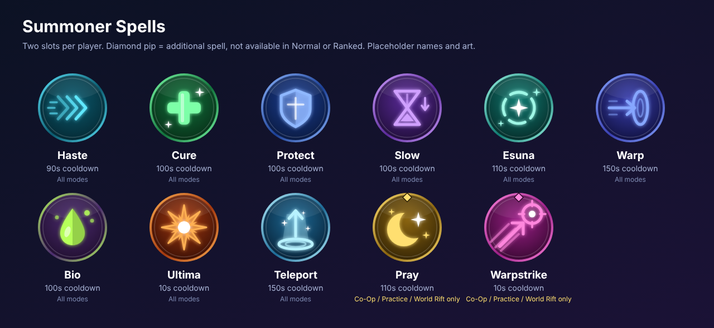

# Summoner Spells



Every player brings **two** summoner spells into a match. Spell names are Final Fantasy-flavoured **placeholders**;
icons are **original placeholder art** (see `docs/images/summoner/*.svg` for the editable sources).

## The roster

### Standard set (all modes, including Normal and Ranked)

| Spell | Plays like | Cooldown | Effect (tunable placeholders) |
|---|---|---|---|
| **Haste** | Ghost | 90 s | +25% movement speed for 10 s |
| **Cure** | Heal | 100 s | Heal 90 (+15 per level) to you and a nearby ally; +30% move speed for 1 s |
| **Protect** | Barrier | 100 s | Shield 105 (+20 per level) for 2 s |
| **Slow** | Exhaust | 100 s | Enemy champion: -30% move speed and -35% damage dealt for 3 s |
| **Esuna** | Cleanse | 110 s | Removes all disabling effects and negative statuses |
| **Warp** | Flash | 150 s | Blink 4.5 units toward the target point |
| **Bio** | Ignite | 100 s | True damage over 5 s (50 +20 per level) and -50% healing received |
| **Ultima** | Smite | 10 s | 600 (+40 per level) true damage to a **neutral monster** |
| **Teleport** | Teleport | 150 s | 3.5 s channel, then travel to an allied structure or minion |

### Additional set (Co-Op vs AI, Practice, World Rift only)

| Spell | Plays like | Cooldown | Effect (tunable placeholders) |
|---|---|---|---|
| **Pray** | Clarity | 110 s | Restore 50% resource to you and 25% to nearby allies |
| **Warpstrike** | Snowball | 10 s | Throw a warp mark (range 14). Press again within 3 s to dash to what it hit |

**Cooldowns are exactly the design brief.** Every other number is a starting point for balance.

## Rules

- Two slots, **no duplicates** (the same spell cannot be in both slots).
- **Normal and Ranked offer only the nine standard spells.** Pray and Warpstrike are refused by the loadout
  and by the cooldown tracker in those modes (`NotAvailableInMode` / `ModeLocked`).
- Co-Op vs AI, Practice and World Rift offer all eleven.
- A match snapshots the loadout at start; later edits do not change a running match.
- Summoner-spell haste uses the same formula as ability haste: `cooldown * 100 / (100 + haste)`.
- Default loadout: **Cure + Warp** (legal in every mode).
- Diamond pip on an icon marks an additional spell, so the cue is shape, not colour alone.

## Code

All under `Assets/Scripts/SummonerSpells/` (namespace `ProjectD.SummonerSpells`).

| File | Role |
|---|---|
| `SummonerSpellCatalog.cs` | Ids, definitions, effect lines, per-mode availability, icon paths |
| `SummonerLoadout.cs` | The two slots and legality rules |
| `SummonerSpellTracker.cs` | Deterministic cooldowns (time is passed in, never read from a clock) |
| `SummonerSpellIcons.cs` | `Resources.Load<Sprite>` icon lookup with caching |
| `Editor/SummonerIconImporter.cs` | Auto-imports `Assets/Resources/UI/SummonerSpells/*.png` as Sprites |

```csharp
var loadout = SummonerLoadout.Default();
loadout.TrySet(1, SummonerSpellId.Haste, GameMode.RankedSolo);          // LoadoutResult.Ok

var spells = new SummonerSpellTracker(loadout, GameMode.RankedSolo);
if (spells.TryCast(0, matchSeconds, out var def) == SummonerCastResult.Success)
    ApplyEffects(def);   // combat system reads def.Effects, def.Targeting, def.RangeUnits

float fill = spells.Remaining01(0, matchSeconds);                      // HUD radial fill
Sprite icon = SummonerSpellIcons.Load(SummonerSpellId.Cure);
```

The catalog describes *what a spell does*; applying the effects belongs to the combat system, which does not
exist as a playable loop yet (see the gap analysis). Until then, casts only start cooldowns.

## Not done yet

- HUD buttons: `HudElementId.SummonerSpell1` / `SummonerSpell2` already have layout slots, but the Greybox
  HUD does not build the buttons yet. They should show `SummonerSpellIcons.Load(...)` with a radial fill from
  `Remaining01`.
- Spell-select UI in Champion Select (calls `TrySet`).
- Effect application, targeting and VFX/SFX.
- Server-side cast validation (mirror `TryCast` in the authoritative server).
- Ultima currently has no "only usable near the jungle" rule beyond its neutral-monster targeting.

## IP note

All Final Fantasy / Square Enix spell names are placeholders. Icons are original vector art with no
reproduced game assets. Licensed art needs a documented chain of title, or replacement with original IP,
before any public build.
